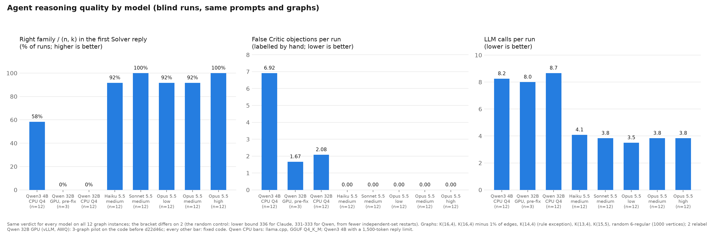

# Kneser agent benchmark

GPU server (64 cores; baselines pinned to cores 16-27, 3 graphs at a time; agent runs pinned to cores 28-31, 3 worker processes; other users' jobs were running on the machine). Standard methods: one thread each, 120 s each, in separate processes; 'time' = when their bracket first closed, counting them as if they ran in parallel. Kushagra's script: recognise (n, k), rule field, one rank, greedy star; falls back to the general minrank agent. Agent: budget 300 s; time = wall time of the run (graph loading and the one-time numba warm-up excluded); for LLM runs the compute time without LLM seconds is in brackets. Every agent bound is re-checked by the independent verifier. Bold = proven exact (lower = upper). '(rule)' = the family rule may be used (only an LLM hypothesis can invoke it, so without an LLM it makes no difference); '(generic only)' = --no-family-rule.

## Analysis (26 Nov 2026, GPU server)

Conditions: other users' jobs ran on the machine throughout. To save time, the agent runs overlapped with the
baselines (on separate cores), so the baseline timings were not measured on an otherwise idle machine. All benchmark Qwen
numbers below are **Qwen2.5-Coder-32B-AWQ with prompts v3, before the plan-results fix d22d46c** (results of checks
run by the Solver's own plan were not shown to the agents). The model ablation below ran Qwen on CPU (llama.cpp) on the
fixed code, because from 18:59 UTC `cuInit` failed on every GPU of the server (error 3): the A6000 at PCI 3D:00.0
reports "GPU requires reset", which blocks CUDA machine-wide until an admin resets it.

- **Proven exact, 20 benchmark graphs:** standard methods 2, Kushagra's script 14, agent without LLM 14, agent +
  Qwen 32B 14 (14 with generic rules only). All 14 are the regular Kneser graphs; the 3 exceptions and 3 controls
  end at gaps for every method; no method claimed a false value, and every agent bound passed the independent
  verifier.
- **Large graphs (4,845-8,855 receivers):** Kushagra's script 3/3, agent + Qwen 32B with the rule 3/3, agent without
  LLM 0/3, agent + Qwen with generic rules only 0/3, standard methods 0/3 (open; no lower bound on K(23,4)). The
  agent computes no spectrum above N = 4000, so its generic search has nothing to try there; the family rule,
  reachable only through an LLM hypothesis, closes these graphs.
- **Speed:** without an LLM the agent is slower than Kushagra's script on the shared exact graphs (median time ratio
  x0.61; it is slower on 8 of 14, by at most 0.6 s), and x135 faster than the standard methods on the 2 graphs
  they prove. On the large graphs the agent's compute time is 5-8x below Kushagra's script (2.3 / 4.5 / 8.0 s vs
  18.7 / 23.0 / 41.6 s), but with the LLM seconds its wall time is about 2x longer on two of them and equal on K(23,4).
- **LLM vs no LLM:** on the 20 benchmark graphs Qwen proved nothing more and its compute time was about the same
  (median x1.05). It adds a median 43 s of LLM time per run (max 56 s). Its value showed only on the large graphs
  (3 proofs that the no-LLM run did not get) and on one control (reg(1000,6): lower bound 332 vs 327, from the extra
  independent-set restarts it asked for).
- **Family guess vs truth.json:** the first Solver reply named the right family and (n, k) in 2/40 runs (with v3 it
  usually asks binomial_match before giving (n, k)); the accepted plan was right in 27/40. On 5 exact Kneser graphs
  (K(40,2), K(53,2), K(12,3), K(21,3), K(17,4), rule allowed) the final label was a wrong "perturbed Kneser",
  after false Critic objections; no verdict changed, because the verdict comes from the checks.
- **What the Critic caught:** 110 challenges in 40 runs. Useful: the false arithmetic of prompts v1 ("C(14,7) = 1001",
  "C(14,5) = 1820"; now also rejected by code), asking for binomial_match before trusting a guess, and making the
  Solver query the rule on K(14,4) (it names no field) before a generic search, as in the chat reference run. Not
  useful: repeated or wrong objections ("degree should be C(12,3) = 220" on K(16,4)).
- **Invalid replies:** 14 of 336 requests (9 were family_rule without arguments), 2 fallbacks to the default plan;
  no JSON syntax errors (vLLM JSON mode; also none in a run without it).
- **Generic rules only vs with the family rule:** identical on the 20 benchmark graphs (the generic spectral search
  closes every regular Kneser graph up to 3,003 receivers); 0 vs 3 on the large graphs.
- **Losses:** to Kushagra's script, on time, on most exact graphs (listed below); never on accuracy: on the 3
  exceptions both reach the same brackets ([84, 93], [286, 287], [495, 507]), on the 3 controls the agent's brackets
  are tighter (e.g. K(16,4)-del0.01: [455, 534] vs [0, 1818]). With prompts v1, Qwen lost to the no-LLM agent on
  K(14,4) ([286, 299] vs [286, 287]); the scheduler's safety net fixed this.
- **Model ablation (bench/ablation/; 6 graphs x 2 relabelling seeds = 12 cells, one blind run per cell):**
  K(16,4), K(16,4) minus 1% of edges, K(14,4) (rule exception), K(13,4), K(15,5), and a random 6-regular graph on
  1000 vertices (non-Kneser control). Every model reaches the same verdict on every graph instance and the same
  bracket on the 10 Kneser-type instances; on the random control the lower bound differs (Claude 336, Qwen 331-333)
  because the Claude Solvers asked for 200-1,000 independent-set restarts and Qwen for 10. So the model changes the
  dialogue and its cost, and only through its plan the bound, never the correctness. The five Claude configurations (Haiku 5.5 medium,
  Sonnet 5.5 medium, Opus 5.5 low / medium / high; 12 runs each) made **0 false Critic objections in 60 runs**,
  named the right family in the first Solver reply in 11-12 of 12 runs, and needed 3.5-4.1 LLM calls per run. Qwen
  2.5-Coder 32B (CPU, fixed code, 12 runs): **25 false objections (2.08 per run)**, the right family in the first
  reply in 0 of 12 runs (on the random control it first called the graph "perturbed Kneser"), 8.7 calls per run;
  the 3-run GPU pilot on the old code (reference traces *_ref_*) gave 1.67 per run. Its Critic objects to numbers
  that are right ("the common-neighbour counts [70, 126, 210, 330] do not match K(16,4)"; "family_rule (14,5) was
  not queried" when it had been, while missing that (14,5) cannot fit 715 or 3003 receivers); it made one real
  catch ("3003 receivers do not match C(14,4) = 1001"). Every objection is labelled with a reason in
  bench/ablation/label_detail.json (rule in labels.py; Qwen CPU and new Claude rows labelled by Claude Code).
- **Qwen3-4B (CPU, GGUF Q4_K_M, fixed code, 12 runs):** at the pipeline's 600-token reply limit (the limit Qwen 32B
  ran under) its JSON was cut off in 26 of 48 requests (logs/kneser_agent_qwen4b_cap600_summary.txt), so it was rerun
  with a 1,500-token limit (the Claude agents had none). Then: **83 false Critic objections (6.92 per run)**, 23
  invalid replies and 9 fallbacks to the default plan (10 rejections were arithmetic caught by code: a K(n,k) whose
  C(n,k) is not the receiver count, or a false "C(a,b) = X"); right family in the first reply in 7 of 12 runs.
  Its false objections are confident mathematics: eigenvalue sums without multiplicities ("148 != 0"), "1820 is not a
  binomial coefficient", "K(16,4) has degree C(12,3)", "a 6-regular graph has at most 7 distinct eigenvalues",
  strongly-regular identities applied to Kneser graphs. It still never changed a verdict: every bound is checked.
- **Model ranking by false objections per run:** Claude (all five configurations) 0, Qwen 32B 2.08 (CPU) / 1.67 (GPU
  pilot), Qwen3-4B 6.92. LLM calls per run: Claude 3.5-4.1, Qwen 8.2-8.7.
- **Fast path (opt-in, no LLM):** recognising K(n,k) from the receiver count and degree and applying the rule proves the
  three large graphs K(20,4), K(17,5), K(23,4) in 4.2 / 14.5 / 21.4 s on 4 quiet cores (Kushagra's script: 18.7 / 23.0 /
  41.6 s; the agent without the fast path leaves gaps), with the same results as before on the 20 benchmark graphs.
- **Two issues the blind agents found:** the summary's sampled common-neighbour counts can miss a rare triangle
  that the exact triangle count sees (reg(1000,6): adjacent pairs "share no neighbour", yet 1 triangle); and the
  run result records the hypothesis of the accepted plan, not the checkpoint's revision. Neither touches a bound.

## Computed summary (benchmark graphs only; generated by bench/report.py)

- 20 graphs. Proven exact: standard methods 2, Kushagra's script 14, agent, no LLM 14, agent, no LLM, fast path 14, agent + Qwen 32B 14 (generic only 14)
- agent + Qwen 32B vs Kushagra's script, both exact (14 graphs): median time ratio x0.92 (min x0.05, max x2.11; > 1 = the agent is faster; agent time = compute time without LLM seconds)
- agent + Qwen 32B vs Kushagra's script, LLM seconds included, both exact (14 graphs): median time ratio x0.01 (min x0.00, max x0.15; > 1 = the agent is faster)
- agent + Qwen 32B vs standard methods, both exact (2 graphs): median time ratio x159.77 (min x130.91, max x188.63; > 1 = the agent is faster; agent time = compute time without LLM seconds)
- agent, no LLM vs Kushagra's script, both exact (14 graphs): median time ratio x0.66 (min x0.25, max x1.26; > 1 = the agent is faster)
- agent, no LLM vs standard methods, both exact (2 graphs): median time ratio x282.00 (min x189.17, max x374.84; > 1 = the agent is faster)
- agent, no LLM, fast path vs Kushagra's script, both exact (14 graphs): median time ratio x1.35 (min x0.32, max x2.75; > 1 = the agent is faster)
- agent, no LLM, fast path vs standard methods, both exact (2 graphs): median time ratio x226.04 (min x176.25, max x275.83; > 1 = the agent is faster)
- agent + Qwen 32B: 40 runs (both rule settings); LLM seconds per run median 43.0 (max 56.3); LLM calls 296; invalid replies 14 of 336 requests, fallbacks to the default 2; Critic challenges 110; safety net ran in 13 runs
  - family guess vs bench/truth.json: first Solver reply right in 2/40, final plan right in 27/40 (wrong -> right during the dialogue: 25; right -> wrong: 0)
  - rule allowed vs no LLM: proven only with the LLM: none; only without: none; both proven (14): no-LLM wall / LLM-run compute time, median x0.86 (> 1 = the LLM run computes less)
  - generic only vs no LLM: proven only with the LLM: none; only without: none; both proven (14): no-LLM wall / LLM-run compute time, median x0.83 (> 1 = the LLM run computes less)

### Every loss of an agent run (rule allowed) to a baseline

- K(21,2) | agent, no LLM: slower than Kushagra's script (0.12 s vs 0.03 s)
- K(21,2) | agent, no LLM, fast path: slower than Kushagra's script (0.06 s vs 0.03 s)
- K(21,2) | agent + Qwen 32B: slower than Kushagra's script (0.14 s vs 0.03 s)
- K(29,2) | agent, no LLM: slower than Kushagra's script (0.11 s vs 0.07 s)
- K(29,2) | agent, no LLM, fast path: slower than Kushagra's script (0.09 s vs 0.07 s)
- K(29,2) | agent + Qwen 32B: slower than Kushagra's script (1.51 s vs 0.07 s)
- K(40,2) | agent + Qwen 32B: slower than Kushagra's script (0.28 s vs 0.24 s)
- K(53,2) | agent, no LLM: slower than Kushagra's script (1.20 s vs 0.68 s)
- K(53,2) | agent + Qwen 32B: slower than Kushagra's script (1.45 s vs 0.68 s)
- K(12,3) | agent, no LLM: slower than Kushagra's script (0.08 s vs 0.03 s)
- K(12,3) | agent, no LLM, fast path: slower than Kushagra's script (0.11 s vs 0.03 s)
- K(12,3) | agent + Qwen 32B: slower than Kushagra's script (0.15 s vs 0.03 s)
- K(13,3) | agent, no LLM: slower than Kushagra's script (0.11 s vs 0.04 s)
- K(13,3) | agent, no LLM, fast path: slower than Kushagra's script (0.08 s vs 0.04 s)
- K(13,3) | agent + Qwen 32B: slower than Kushagra's script (0.13 s vs 0.04 s)
- K(16,3) | agent, no LLM: slower than Kushagra's script (0.20 s vs 0.13 s)
- K(16,3) | agent + Qwen 32B: slower than Kushagra's script (0.23 s vs 0.13 s)
- K(21,3) | agent + Qwen 32B: slower than Kushagra's script (0.72 s vs 0.71 s)
- K(15,4) | agent, no LLM: slower than Kushagra's script (1.54 s vs 0.80 s)
- K(17,4) | agent, no LLM: slower than Kushagra's script (2.98 s vs 2.32 s)
- K(15,5) | agent, no LLM: slower than Kushagra's script (6.81 s vs 4.38 s)

## Per-graph results

| graph | receivers | standard methods | time | Kushagra's script | time | agent, no LLM | time | agent, no LLM, fast path | time | agent + Qwen 32B (rule) | time | agent + Qwen 32B (generic only) | time |
|---|---|---|---|---|---|---|---|---|---|---|---|---|---|
| K(21,2) | 210 | [20, 21] | open | **20** | 0.03 s | **20** | 0.12 s | **20** | 0.06 s | **20** | 27.20 s (0.14) | **20** | 49.98 s (0.17) |
| K(29,2) | 406 | [28, 29] | open | **28** | 0.07 s | **28** | 0.11 s | **28** | 0.09 s | **28** | 43.86 s (1.51) | **28** | 41.69 s (1.27) |
| K(40,2) | 780 | **39** | 36.13 s | **39** | 0.24 s | **39** | 0.19 s | **39** | 0.20 s | **39** | 38.38 s (0.28) | **39** | 48.69 s (0.15) |
| K(53,2) | 1378 | [52, 59.98] | open | **52** | 0.68 s | **52** | 1.20 s | **52** | 0.36 s | **52** | 55.38 s (1.45) | **52** | 42.11 s (1.04) |
| K(12,3) | 220 | **55** | 29.24 s | **55** | 0.03 s | **55** | 0.08 s | **55** | 0.11 s | **55** | 43.74 s (0.15) | **55** | 41.77 s (0.14) |
| K(13,3) | 286 | [66, 71.5] | open | **66** | 0.04 s | **66** | 0.11 s | **66** | 0.08 s | **66** | 42.39 s (0.13) | **66** | 35.81 s (0.10) |
| K(16,3) | 560 | [105, 160] | open | **105** | 0.13 s | **105** | 0.20 s | **105** | 0.11 s | **105** | 28.98 s (0.23) | **105** | 41.96 s (0.36) |
| K(18,3) | 816 | [136, 411] | open | **136** | 0.30 s | **136** | 0.29 s | **136** | 0.22 s | **136** | 44.33 s (0.27) | **136** | 40.15 s (0.45) |
| K(21,3) | 1330 | [190, 1152] | open | **190** | 0.71 s | **190** | 0.56 s | **190** | 0.35 s | **190** | 40.44 s (0.72) | **190** | 37.45 s (0.64) |
| K(13,4) | 715 | [220, 604] | open | **220** | 0.28 s | **220** | 0.27 s | **220** | 0.21 s | **220** | 30.15 s (0.25) | **220** | 48.80 s (0.38) |
| K(15,4) | 1365 | [364, 1341] | open | **364** | 0.80 s | **364** | 1.54 s | **364** | 0.39 s | **364** | 29.54 s (0.52) | **364** | 50.27 s (1.95) |
| K(16,4) | 1820 | [455, 1800] | open | **455** | 1.90 s | **455** | 1.58 s | **455** | 0.69 s | **455** | 52.97 s (0.90) | **455** | 47.33 s (1.31) |
| K(17,4) | 2380 | [560, 2368] | open | **560** | 2.32 s | **560** | 2.98 s | **560** | 1.26 s | **560** | 40.86 s (1.90) | **560** | 49.09 s (1.99) |
| K(15,5) | 3003 | [1001, 3003] | open | **1001** | 4.38 s | **1001** | 6.81 s | **1001** | 2.59 s | **1001** | 28.52 s (2.88) | **1001** | 40.47 s (4.10) |
| K(10,4) (exception) | 210 | [84, 121] | open | [84, 93] | not exact | [84, 93] | 0.15 s | [84, 93] | 0.37 s | [84, 93] | 39.02 s (0.51) | [84, 93] | 48.69 s (0.52) |
| K(14,4) (exception) | 1001 | [286, 961] | open | [286, 287] | not exact | [286, 287] | 2.20 s | [286, 287] | 1.97 s | [286, 287] | 58.70 s (2.36) | [286, 287] | 28.68 s (2.37) |
| K(13,5) (exception) | 1287 | [378, 1287] | open | [495, 507] | not exact | [495, 507] | 4.15 s | [495, 507] | 2.92 s | [495, 507] | 58.76 s (3.44) | [495, 507] | 47.40 s (3.44) |
| K(16,4)-del0.01 (control) | 1820 | [455, 1800] | open | [0, 1818] | not exact | [455, 534] | 0.80 s | [455, 534] | 0.46 s | [455, 534] | 45.06 s (1.21) | [455, 534] | 51.84 s (0.66) |
| K(18,3)-del0.01 (control) | 816 | [136, 433] | open | [136, 732] | not exact | [136, 152] | 0.12 s | [136, 152] | 0.11 s | [136, 152] | 49.73 s (0.45) | [136, 152] | 50.00 s (0.44) |
| reg(1000,6) (control) | 1000 | [294, 994] | open | [293, 998] | not exact | [327, 537] | 0.19 s | [327, 537] | 0.17 s | [332, 537] | 53.88 s (0.59) | [332, 537] | 51.76 s (0.60) |
| K(20,4) (large) | 4845 | [969, 4841] | open | **969** | 18.66 s | [969, 1098] | 2.51 s | **969** | 2.47 s | **969** | 40.27 s (2.25) | [969, 1098] | 45.05 s (0.35) |
| K(17,5) (large) | 6188 | [1491, 6188] | open | **1820** | 22.98 s | [1820, 2106] | 9.73 s | **1820** | 10.61 s | **1820** | 44.15 s (4.53) | [1820, 2106] | 97.28 s (53.14) |
| K(23,4) (large) | 8855 | [-, 8855] | open | **1540** | 41.62 s | [1540, 1789] | 14.94 s | **1540** | 14.34 s | **1540** | 40.85 s (8.04) | [1540, 1771] | 111.55 s (66.54) |

## Model ablation: blind agents on the three reference cases (bench/ablation/)

Each run gives the Solver, Critic and Verifier roles to one model answering blind (bench/ablation/README.md). Claude rows: fixed code (d22d46c). Qwen rows: GPU server, prompts v3, code before d22d46c. One run per cell; false objections labelled by hand (bench/ablation/false_objections.json).

| graph | model | verdict | bracket | LLM calls | invalid | fallbacks | (n, k) in first reply | Critic objections | false | safety net | codes tried |
|---|---|---|---|---|---|---|---|---|---|---|---|
| K_16_4_s3 | Qwen2.5-32B | proven | [455, 455] | 8 | 0 | 0 | no | 3 | 2 | no | 5 |
| K_16_4_s3 | Qwen2.5-32B-cpu | proven | [455, 455] | 9 | 1 | 0 | no | 3 | 2 | no | 1 |
| K_16_4_s3 | Qwen3-4B-cpu | proven | [455, 455] | 4 | 2 | 1 | no | 9 | 5 | no | 0 |
| K_16_4_s3 | haiku-med | proven | [455, 455] | 3 | 0 | 0 | yes | 0 | 0 | no | 1 |
| K_16_4_s3 | sonnet-med | proven | [455, 455] | 3 | 0 | 0 | yes | 0 | 0 | no | 1 |
| K_16_4_s3 | opus-low | proven | [455, 455] | 3 | 0 | 0 | yes | 0 | 0 | no | 1 |
| K_16_4_s3 | opus-med | proven | [455, 455] | 3 | 0 | 0 | yes | 0 | 0 | no | 1 |
| K_16_4_s3 | opus-high | proven | [455, 455] | 3 | 0 | 0 | yes | 0 | 0 | no | 1 |
| K_16_4-del0.01_s0 | Qwen2.5-32B | gap | [455, 534] | 10 | 1 | 0 | no | 3 | 3 | yes | 0 |
| K_16_4-del0.01_s0 | Qwen2.5-32B-cpu | gap | [455, 534] | 10 | 1 | 0 | no | 3 | 2 | yes | 0 |
| K_16_4-del0.01_s0 | Qwen3-4B-cpu | gap | [455, 534] | 9 | 0 | 0 | no | 16 | 2 | yes | 0 |
| K_16_4-del0.01_s0 | haiku-med | gap | [455, 534] | 4 | 0 | 0 | no | 0 | 0 | yes | 1 |
| K_16_4-del0.01_s0 | sonnet-med | gap | [455, 534] | 6 | 0 | 0 | yes | 2 | 0 | yes | 1 |
| K_16_4-del0.01_s0 | opus-low | gap | [455, 534] | 4 | 0 | 0 | yes | 0 | 0 | yes | 1 |
| K_16_4-del0.01_s0 | opus-med | gap | [455, 534] | 4 | 0 | 0 | yes | 1 | 0 | yes | 1 |
| K_16_4-del0.01_s0 | opus-high | gap | [455, 534] | 4 | 0 | 0 | yes | 0 | 0 | yes | 3 |
| K_14_4_s0 | Qwen2.5-32B | gap | [286, 287] | 6 | 0 | 0 | no | 1 | 0 | yes | 31 |
| K_14_4_s0 | Qwen2.5-32B-cpu | gap | [286, 287] | 9 | 0 | 0 | no | 4 | 3 | yes | 31 |
| K_14_4_s0 | Qwen3-4B-cpu | gap | [286, 287] | 10 | 2 | 1 | yes | 23 | 16 | yes | 30 |
| K_14_4_s0 | haiku-med | gap | [286, 287] | 4 | 0 | 0 | yes | 0 | 0 | yes | 31 |
| K_14_4_s0 | sonnet-med | gap | [286, 287] | 4 | 0 | 0 | yes | 0 | 0 | yes | 31 |
| K_14_4_s0 | opus-low | gap | [286, 287] | 4 | 0 | 0 | yes | 0 | 0 | yes | 31 |
| K_14_4_s0 | opus-med | gap | [286, 287] | 4 | 0 | 0 | yes | 0 | 0 | yes | 31 |
| K_14_4_s0 | opus-high | gap | [286, 287] | 4 | 0 | 0 | yes | 1 | 0 | yes | 31 |
| K_16_4_s1 | Qwen2.5-32B-cpu | proven | [455, 455] | 8 | 0 | 0 | no | 3 | 2 | no | 5 |
| K_16_4_s1 | Qwen3-4B-cpu | proven | [455, 455] | 12 | 6 | 2 | no | 16 | 9 | no | 1 |
| K_16_4_s1 | haiku-med | proven | [455, 455] | 3 | 0 | 0 | yes | 0 | 0 | no | 1 |
| K_16_4_s1 | sonnet-med | proven | [455, 455] | 3 | 0 | 0 | yes | 0 | 0 | no | 1 |
| K_16_4_s1 | opus-low | proven | [455, 455] | 3 | 0 | 0 | yes | 0 | 0 | no | 1 |
| K_16_4_s1 | opus-med | proven | [455, 455] | 3 | 0 | 0 | yes | 0 | 0 | no | 1 |
| K_16_4_s1 | opus-high | proven | [455, 455] | 4 | 1 | 0 | yes | 0 | 0 | no | 1 |
| K_16_4-del0.01_s1 | Qwen2.5-32B-cpu | gap | [455, 534] | 9 | 0 | 0 | no | 3 | 3 | yes | 0 |
| K_16_4-del0.01_s1 | Qwen3-4B-cpu | gap | [455, 534] | 9 | 0 | 0 | no | 15 | 10 | yes | 1 |
| K_16_4-del0.01_s1 | haiku-med | gap | [455, 534] | 8 | 0 | 0 | yes | 11 | 0 | yes | 1 |
| K_16_4-del0.01_s1 | sonnet-med | gap | [455, 534] | 6 | 0 | 0 | yes | 3 | 0 | yes | 1 |
| K_16_4-del0.01_s1 | opus-low | gap | [455, 534] | 4 | 0 | 0 | no | 0 | 0 | yes | 1 |
| K_16_4-del0.01_s1 | opus-med | gap | [455, 534] | 4 | 0 | 0 | no | 0 | 0 | yes | 1 |
| K_16_4-del0.01_s1 | opus-high | gap | [455, 534] | 4 | 0 | 0 | yes | 0 | 0 | yes | 2 |
| K_14_4_s1 | Qwen2.5-32B-cpu | gap | [286, 287] | 9 | 0 | 0 | no | 3 | 0 | yes | 31 |
| K_14_4_s1 | Qwen3-4B-cpu | gap | [286, 287] | 10 | 2 | 1 | yes | 20 | 9 | yes | 30 |
| K_14_4_s1 | haiku-med | gap | [286, 287] | 4 | 0 | 0 | yes | 3 | 0 | yes | 35 |
| K_14_4_s1 | sonnet-med | gap | [286, 287] | 4 | 0 | 0 | yes | 0 | 0 | yes | 31 |
| K_14_4_s1 | opus-low | gap | [286, 287] | 4 | 0 | 0 | yes | 0 | 0 | yes | 31 |
| K_14_4_s1 | opus-med | gap | [286, 287] | 5 | 1 | 0 | yes | 0 | 0 | yes | 31 |
| K_14_4_s1 | opus-high | gap | [286, 287] | 4 | 0 | 0 | yes | 0 | 0 | yes | 31 |
| K_13_4_s0 | Qwen2.5-32B-cpu | proven | [220, 220] | 8 | 0 | 0 | no | 4 | 3 | no | 5 |
| K_13_4_s0 | Qwen3-4B-cpu | proven | [220, 220] | 7 | 2 | 0 | yes | 15 | 7 | no | 0 |
| K_13_4_s0 | haiku-med | proven | [220, 220] | 3 | 0 | 0 | yes | 0 | 0 | no | 1 |
| K_13_4_s0 | sonnet-med | proven | [220, 220] | 3 | 0 | 0 | yes | 0 | 0 | no | 1 |
| K_13_4_s0 | opus-low | proven | [220, 220] | 3 | 0 | 0 | yes | 0 | 0 | no | 1 |
| K_13_4_s0 | opus-med | proven | [220, 220] | 3 | 0 | 0 | yes | 0 | 0 | no | 1 |
| K_13_4_s0 | opus-high | proven | [220, 220] | 3 | 0 | 0 | yes | 0 | 0 | no | 1 |
| K_13_4_s1 | Qwen2.5-32B-cpu | proven | [220, 220] | 7 | 0 | 0 | no | 2 | 0 | no | 1 |
| K_13_4_s1 | Qwen3-4B-cpu | proven | [220, 220] | 7 | 3 | 1 | yes | 7 | 0 | no | 1 |
| K_13_4_s1 | haiku-med | proven | [220, 220] | 3 | 0 | 0 | yes | 0 | 0 | no | 1 |
| K_13_4_s1 | sonnet-med | proven | [220, 220] | 3 | 0 | 0 | yes | 2 | 0 | no | 1 |
| K_13_4_s1 | opus-low | proven | [220, 220] | 3 | 0 | 0 | yes | 0 | 0 | no | 1 |
| K_13_4_s1 | opus-med | proven | [220, 220] | 4 | 1 | 0 | yes | 0 | 0 | no | 1 |
| K_13_4_s1 | opus-high | proven | [220, 220] | 3 | 0 | 0 | yes | 0 | 0 | no | 1 |
| K_15_5_s0 | Qwen2.5-32B-cpu | proven | [1001, 1001] | 9 | 0 | 0 | no | 3 | 2 | no | 2 |
| K_15_5_s0 | Qwen3-4B-cpu | proven | [1001, 1001] | 8 | 2 | 1 | yes | 12 | 8 | no | 1 |
| K_15_5_s0 | haiku-med | proven | [1001, 1001] | 3 | 0 | 0 | yes | 0 | 0 | no | 1 |
| K_15_5_s0 | sonnet-med | proven | [1001, 1001] | 3 | 0 | 0 | yes | 0 | 0 | no | 1 |
| K_15_5_s0 | opus-low | proven | [1001, 1001] | 3 | 0 | 0 | yes | 0 | 0 | no | 1 |
| K_15_5_s0 | opus-med | proven | [1001, 1001] | 3 | 0 | 0 | yes | 0 | 0 | no | 1 |
| K_15_5_s0 | opus-high | proven | [1001, 1001] | 3 | 0 | 0 | yes | 0 | 0 | no | 1 |
| K_15_5_s1 | Qwen2.5-32B-cpu | proven | [1001, 1001] | 5 | 0 | 0 | no | 1 | 0 | no | 1 |
| K_15_5_s1 | Qwen3-4B-cpu | proven | [1001, 1001] | 5 | 4 | 2 | no | 0 | 0 | no | 8 |
| K_15_5_s1 | haiku-med | proven | [1001, 1001] | 3 | 0 | 0 | yes | 0 | 0 | no | 1 |
| K_15_5_s1 | sonnet-med | proven | [1001, 1001] | 3 | 0 | 0 | yes | 0 | 0 | no | 1 |
| K_15_5_s1 | opus-low | proven | [1001, 1001] | 3 | 0 | 0 | yes | 0 | 0 | no | 1 |
| K_15_5_s1 | opus-med | proven | [1001, 1001] | 4 | 1 | 0 | yes | 0 | 0 | no | 1 |
| K_15_5_s1 | opus-high | proven | [1001, 1001] | 5 | 0 | 0 | yes | 3 | 0 | no | 1 |
| reg_1000_6_s0 | Qwen2.5-32B-cpu | gap | [332, 537] | 10 | 1 | 0 | no | 4 | 4 | yes | 0 |
| reg_1000_6_s0 | Qwen3-4B-cpu | gap | [331, 537] | 9 | 0 | 0 | yes | 18 | 11 | yes | 3 |
| reg_1000_6_s0 | haiku-med | gap | [336, 537] | 4 | 0 | 0 | yes | 3 | 0 | yes | 0 |
| reg_1000_6_s0 | sonnet-med | gap | [336, 537] | 4 | 0 | 0 | yes | 0 | 0 | yes | 0 |
| reg_1000_6_s0 | opus-low | gap | [336, 537] | 4 | 0 | 0 | yes | 0 | 0 | yes | 0 |
| reg_1000_6_s0 | opus-med | gap | [336, 537] | 4 | 0 | 0 | yes | 0 | 0 | yes | 1 |
| reg_1000_6_s0 | opus-high | gap | [336, 537] | 4 | 0 | 0 | yes | 0 | 0 | yes | 1 |
| reg_1000_6_s1 | Qwen2.5-32B-cpu | gap | [333, 537] | 11 | 2 | 0 | no | 5 | 4 | yes | 0 |
| reg_1000_6_s1 | Qwen3-4B-cpu | gap | [333, 537] | 9 | 0 | 0 | yes | 16 | 6 | yes | 2 |
| reg_1000_6_s1 | haiku-med | gap | [336, 537] | 7 | 1 | 0 | yes | 4 | 0 | yes | 0 |
| reg_1000_6_s1 | sonnet-med | gap | [336, 537] | 4 | 0 | 0 | yes | 0 | 0 | yes | 0 |
| reg_1000_6_s1 | opus-low | gap | [336, 537] | 4 | 0 | 0 | yes | 0 | 0 | yes | 1 |
| reg_1000_6_s1 | opus-med | gap | [336, 537] | 5 | 1 | 0 | yes | 2 | 0 | yes | 2 |
| reg_1000_6_s1 | opus-high | gap | [336, 537] | 5 | 1 | 0 | yes | 0 | 0 | yes | 2 |

## Every run with an LLM in the loop

llm = chat: an assistant answered as the agents through the file-based chat backend (reference runs); otherwise the named model on the server (vLLM, GPU 4). prompts: v1 = branch prompts; v2, v3 = after the fixes described in MERGE_NOTES.md and the commit messages.

| graph | llm | prompts | rule | verdict | bracket | wall | LLM s | compute | calls | invalid | Critic challenges | final hypothesis | truth |
|---|---|---|---|---|---|---|---|---|---|---|---|---|---|
| K_16_4_s3_chat | chat | - | yes | proven | [455, 455] | 55.4 s | 54.8 | 0.52 s | 4 | 0 | 1 | Kneser graph K(n,k) {'n': 16, 'k': 4} | kneser 16,4 |
| K_16_4-del0.01_s0_chat | chat | - | yes | gap | [455, 534] | 77.0 s | 61.6 | 15.39 s | 3 | 0 | 0 | Kneser K(16,4) with about 1% of its edges deleted (not an exact Kneser graph) {'n': 16, 'k': 4, 'deleted_fraction': 0.01} | kneser with deleted edges 16,4 |
| K_14_4_s0_chat | chat | - | yes | gap | [286, 287] | 92.9 s | 82.0 | 10.87 s | 5 | 0 | 1 | Kneser graph K(n,k) {'n': 14, 'k': 4} | kneser 14,4 |
| K_16_4_s3 | Qwen2.5-Coder-32B-Instruct-AWQ | v1 | yes | proven | [455, 455] | 68.8 s | 67.9 | 0.85 s | 7 | 0 | 3 | Kneser {'n': 16, 'k': 4} | kneser 16,4 |
| K_16_4-del0.01_s0 | Qwen2.5-Coder-32B-Instruct-AWQ | v1 | yes | gap | [455, 534] | 67.3 s | 66.6 | 0.65 s | 8 | 0 | 3 | Kneser {'n': 16, 'k': 4} | kneser with deleted edges 16,4 |
| K_14_4_s0 | Qwen2.5-Coder-32B-Instruct-AWQ | v1 | yes | gap | [286, 299] | 72.4 s | 71.6 | 0.87 s | 9 | 1 | 3 | Kneser {'n': 14, 'k': 7} | kneser 14,4 |
| K_16_4_s3_nojsonmode | Qwen2.5-Coder-32B-Instruct-AWQ | v1 | yes | proven | [455, 455] | 84.8 s | 84.0 | 0.89 s | 9 | 2 | 3 | Kneser {} | kneser 16,4 |
| K_16_4_s3 | Qwen2.5-Coder-32B-Instruct-AWQ | v2 | yes | proven | [455, 455] | 45.7 s | 44.8 | 0.93 s | 8 | 0 | 3 | Kneser {'n': 16, 'k': 4} | kneser 16,4 |
| K_14_4_s0 | Qwen2.5-Coder-32B-Instruct-AWQ | v2 | yes | gap | [286, 287] | 56.5 s | 53.3 | 3.26 s | 9 | 1 | 3 | perturbed Kneser {'n': 14, 'k': 4} | kneser 14,4 |
| K_16_4_s3 | Qwen2.5-Coder-32B-Instruct-AWQ | v3 | yes | proven | [455, 455] | 37.3 s | 36.1 | 1.20 s | 7 | 0 | 3 | perturbed Kneser {} | kneser 16,4 |
| K_16_4-del0.01_s0 | Qwen2.5-Coder-32B-Instruct-AWQ | v3 | yes | gap | [455, 534] | 49.6 s | 48.2 | 1.36 s | 9 | 0 | 3 | none {} | kneser with deleted edges 16,4 |
| K_14_4_s0 | Qwen2.5-Coder-32B-Instruct-AWQ | v3 | yes | gap | [286, 287] | 28.4 s | 25.6 | 2.89 s | 5 | 1 | 3 | Kneser {'n': 14, 'k': 4} | kneser 14,4 |
| K_16_4-del0.01_s0_opus-low | chat | v3 | yes | gap | [455, 534] | 96.5 s | 13.6 | 82.91 s | 3 | 0 | 0 | perturbed Kneser {} | kneser with deleted edges 16,4 |
| K_14_4_s0_opus-low | chat | v3 | yes | gap | [286, 287] | 98.3 s | 41.3 | 56.95 s | 3 | 0 | 0 | Kneser {} | kneser 14,4 |
| K_16_4_s3_opus-low | chat | v3 | yes | proven | [455, 455] | 100.4 s | 8.9 | 91.50 s | 2 | 0 | 0 | Kneser {} | kneser 16,4 |
| K_16_4_s3_opus-med | chat | v3 | yes | proven | [455, 455] | 102.9 s | 12.4 | 90.45 s | 2 | 0 | 0 | Kneser {} | kneser 16,4 |
| K_16_4_s3_sonnet-med | chat | v3 | yes | proven | [455, 455] | 106.3 s | 13.9 | 92.37 s | 2 | 0 | 0 | Kneser {'n': 16, 'k': 4} | kneser 16,4 |
| K_16_4_s3_opus-high | chat | v3 | yes | proven | [455, 455] | 108.5 s | 16.4 | 92.05 s | 2 | 0 | 0 | Kneser K(n,k), likely K(16,4) {'n': 16, 'k': 4} | kneser 16,4 |
| K_14_4_s0_sonnet-med | chat | v3 | yes | gap | [286, 287] | 110.0 s | 52.3 | 57.67 s | 3 | 0 | 0 | Kneser K(14,4) {'n': 14, 'k': 4} | kneser 14,4 |
| K_16_4_s3_haiku-med | chat | v3 | yes | proven | [455, 455] | 110.9 s | 18.4 | 92.46 s | 2 | 0 | 0 | Kneser-type graph K(n,k) {} | kneser 16,4 |
| K_16_4-del0.01_s0_opus-med | chat | v3 | yes | gap | [455, 534] | 114.4 s | 19.6 | 94.76 s | 3 | 0 | 0 | perturbed Kneser (likely K(16,4) with a few edges deleted) {} | kneser with deleted edges 16,4 |
| K_14_4_s0_haiku-med | chat | v3 | yes | gap | [286, 287] | 115.8 s | 58.3 | 57.47 s | 3 | 0 | 0 | Kneser K(14,4) {'n': 14, 'k': 4} | kneser 14,4 |
| K_14_4_s0_opus-med | chat | v3 | yes | gap | [286, 287] | 116.6 s | 59.3 | 57.29 s | 3 | 0 | 0 | Kneser graph K(n,k) (likely K(14,4), to be confirmed by binomial_match) {} | kneser 14,4 |
| K_16_4-del0.01_s0_haiku-med | chat | v3 | yes | gap | [455, 534] | 120.0 s | 25.6 | 94.38 s | 3 | 0 | 0 | perturbed Kneser {} | kneser with deleted edges 16,4 |
| K_16_4-del0.01_s0_sonnet-med | chat | v3 | yes | gap | [455, 534] | 126.8 s | 31.5 | 95.31 s | 5 | 0 | 1 | perturbed Kneser K(16,4) {'n': 16, 'k': 4} | kneser with deleted edges 16,4 |
| K_16_4-del0.01_s0_opus-high | chat | v3 | yes | gap | [455, 534] | 130.0 s | 27.1 | 102.83 s | 3 | 0 | 0 | perturbed Kneser (possibly K(16,4) with some edges deleted) {'n': 16, 'k': 4} | kneser with deleted edges 16,4 |
| K_14_4_s0_opus-high | chat | v3 | yes | gap | [286, 287] | 131.7 s | 75.2 | 56.44 s | 3 | 0 | 0 | Kneser graph K(n,k) {} | kneser 14,4 |
| K_21_2_s0 | Qwen2.5-Coder-32B-Instruct-AWQ | v3 | yes | proven | [20, 20] | 27.2 s | 27.1 | 0.14 s | 6 | 0 | 2 | Kneser {'n': 21, 'k': 2} | kneser 21,2 |
| K_21_2_s0_nofam | Qwen2.5-Coder-32B-Instruct-AWQ | v3 | no | proven | [20, 20] | 50.0 s | 49.8 | 0.17 s | 8 | 0 | 3 | Kneser {'n': 21, 'k': 2} | kneser 21,2 |
| K_29_2_s0 | Qwen2.5-Coder-32B-Instruct-AWQ | v3 | yes | proven | [28, 28] | 43.9 s | 42.4 | 1.51 s | 7 | 0 | 3 | Kneser {'n': 29, 'k': 2} | kneser 29,2 |
| K_29_2_s0_nofam | Qwen2.5-Coder-32B-Instruct-AWQ | v3 | no | proven | [28, 28] | 41.7 s | 40.4 | 1.27 s | 7 | 0 | 3 | Kneser {'n': 29, 'k': 2} | kneser 29,2 |
| K_40_2_s0 | Qwen2.5-Coder-32B-Instruct-AWQ | v3 | yes | proven | [39, 39] | 38.4 s | 38.1 | 0.28 s | 7 | 0 | 3 | perturbed Kneser {} | kneser 40,2 |
| K_40_2_s0_nofam | Qwen2.5-Coder-32B-Instruct-AWQ | v3 | no | proven | [39, 39] | 48.7 s | 48.5 | 0.15 s | 7 | 0 | 3 | perturbed Kneser {'n': 40, 'k': 2} | kneser 40,2 |
| K_53_2_s0 | Qwen2.5-Coder-32B-Instruct-AWQ | v3 | yes | proven | [52, 52] | 55.4 s | 53.9 | 1.45 s | 8 | 0 | 3 | perturbed Kneser {} | kneser 53,2 |
| K_53_2_s0_nofam | Qwen2.5-Coder-32B-Instruct-AWQ | v3 | no | proven | [52, 52] | 42.1 s | 41.1 | 1.04 s | 7 | 0 | 2 | Kneser {} | kneser 53,2 |
| K_12_3_s0 | Qwen2.5-Coder-32B-Instruct-AWQ | v3 | yes | proven | [55, 55] | 43.7 s | 43.6 | 0.15 s | 7 | 0 | 3 | perturbed Kneser {'n': 12, 'k': 3} | kneser 12,3 |
| K_12_3_s0_nofam | Qwen2.5-Coder-32B-Instruct-AWQ | v3 | no | proven | [55, 55] | 41.8 s | 41.6 | 0.14 s | 7 | 0 | 3 | Kneser {'n': 12, 'k': 3} | kneser 12,3 |
| K_13_3_s0 | Qwen2.5-Coder-32B-Instruct-AWQ | v3 | yes | proven | [66, 66] | 42.4 s | 42.3 | 0.13 s | 7 | 0 | 3 | Kneser {'n': 13, 'k': 3} | kneser 13,3 |
| K_13_3_s0_nofam | Qwen2.5-Coder-32B-Instruct-AWQ | v3 | no | proven | [66, 66] | 35.8 s | 35.7 | 0.10 s | 7 | 0 | 3 | Kneser {'n': 13, 'k': 3} | kneser 13,3 |
| K_16_3_s0 | Qwen2.5-Coder-32B-Instruct-AWQ | v3 | yes | proven | [105, 105] | 29.0 s | 28.8 | 0.23 s | 6 | 0 | 2 | Kneser {'n': 16, 'k': 3} | kneser 16,3 |
| K_16_3_s0_nofam | Qwen2.5-Coder-32B-Instruct-AWQ | v3 | no | proven | [105, 105] | 42.0 s | 41.6 | 0.36 s | 7 | 0 | 3 | perturbed Kneser {} | kneser 16,3 |
| K_18_3_s0 | Qwen2.5-Coder-32B-Instruct-AWQ | v3 | yes | proven | [136, 136] | 44.3 s | 44.1 | 0.27 s | 7 | 0 | 3 | Kneser {'n': 18, 'k': 3} | kneser 18,3 |
| K_18_3_s0_nofam | Qwen2.5-Coder-32B-Instruct-AWQ | v3 | no | proven | [136, 136] | 40.2 s | 39.7 | 0.45 s | 7 | 0 | 3 | Kneser {'n': 18, 'k': 3} | kneser 18,3 |
| K_21_3_s0 | Qwen2.5-Coder-32B-Instruct-AWQ | v3 | yes | proven | [190, 190] | 40.4 s | 39.7 | 0.72 s | 7 | 0 | 3 | perturbed Kneser {'n': 21, 'k': 3} | kneser 21,3 |
| K_21_3_s0_nofam | Qwen2.5-Coder-32B-Instruct-AWQ | v3 | no | proven | [190, 190] | 37.4 s | 36.8 | 0.64 s | 7 | 0 | 3 | Kneser {'n': 21, 'k': 3} | kneser 21,3 |
| K_13_4_s0 | Qwen2.5-Coder-32B-Instruct-AWQ | v3 | yes | proven | [220, 220] | 30.2 s | 29.9 | 0.25 s | 6 | 0 | 2 | Kneser {'n': 13, 'k': 4} | kneser 13,4 |
| K_13_4_s0_nofam | Qwen2.5-Coder-32B-Instruct-AWQ | v3 | no | proven | [220, 220] | 48.8 s | 48.4 | 0.38 s | 7 | 0 | 3 | Kneser {'n': 13, 'k': 4} | kneser 13,4 |
| K_15_4_s0 | Qwen2.5-Coder-32B-Instruct-AWQ | v3 | yes | proven | [364, 364] | 29.5 s | 29.0 | 0.52 s | 6 | 0 | 2 | Kneser {'n': 15, 'k': 4} | kneser 15,4 |
| K_15_4_s0_nofam | Qwen2.5-Coder-32B-Instruct-AWQ | v3 | no | proven | [364, 364] | 50.3 s | 48.3 | 1.95 s | 7 | 0 | 3 | Kneser {'n': 15, 'k': 4} | kneser 15,4 |
| K_16_4_s0 | Qwen2.5-Coder-32B-Instruct-AWQ | v3 | yes | proven | [455, 455] | 53.0 s | 52.1 | 0.90 s | 7 | 0 | 3 | Kneser {'n': 16, 'k': 4} | kneser 16,4 |
| K_16_4_s0_nofam | Qwen2.5-Coder-32B-Instruct-AWQ | v3 | no | proven | [455, 455] | 47.3 s | 46.0 | 1.31 s | 9 | 2 | 3 | perturbed Kneser {} | kneser 16,4 |
| K_17_4_s0 | Qwen2.5-Coder-32B-Instruct-AWQ | v3 | yes | proven | [560, 560] | 40.9 s | 39.0 | 1.90 s | 7 | 0 | 3 | perturbed Kneser {} | kneser 17,4 |
| K_17_4_s0_nofam | Qwen2.5-Coder-32B-Instruct-AWQ | v3 | no | proven | [560, 560] | 49.1 s | 47.1 | 1.99 s | 8 | 2 | 3 | Kneser {'n': 17, 'k': 4} | kneser 17,4 |
| K_15_5_s0 | Qwen2.5-Coder-32B-Instruct-AWQ | v3 | yes | proven | [1001, 1001] | 28.5 s | 25.6 | 2.88 s | 6 | 0 | 2 | Kneser {'n': 15, 'k': 5} | kneser 15,5 |
| K_15_5_s0_nofam | Qwen2.5-Coder-32B-Instruct-AWQ | v3 | no | proven | [1001, 1001] | 40.5 s | 36.4 | 4.10 s | 7 | 0 | 3 | Kneser {'n': 15, 'k': 5} | kneser 15,5 |
| K_10_4_s0 | Qwen2.5-Coder-32B-Instruct-AWQ | v3 | yes | gap | [84, 93] | 39.0 s | 38.5 | 0.51 s | 7 | 0 | 2 | Kneser {} | kneser 10,4 |
| K_10_4_s0_nofam | Qwen2.5-Coder-32B-Instruct-AWQ | v3 | no | gap | [84, 93] | 48.7 s | 48.2 | 0.52 s | 8 | 0 | 3 | perturbed Kneser {} | kneser 10,4 |
| K_14_4_s0 | Qwen2.5-Coder-32B-Instruct-AWQ | v3 | yes | gap | [286, 287] | 58.7 s | 56.3 | 2.36 s | 9 | 1 | 3 | Kneser {'n': 14, 'k': 4} | kneser 14,4 |
| K_14_4_s0_nofam | Qwen2.5-Coder-32B-Instruct-AWQ | v3 | no | gap | [286, 287] | 28.7 s | 26.3 | 2.37 s | 5 | 0 | 1 | Kneser {'n': 14, 'k': 4} | kneser 14,4 |
| K_13_5_s0 | Qwen2.5-Coder-32B-Instruct-AWQ | v3 | yes | gap | [495, 507] | 58.8 s | 55.3 | 3.44 s | 9 | 1 | 3 | Kneser {'n': 13, 'k': 5} | kneser 13,5 |
| K_13_5_s0_nofam | Qwen2.5-Coder-32B-Instruct-AWQ | v3 | no | gap | [495, 507] | 47.4 s | 44.0 | 3.44 s | 8 | 0 | 3 | Kneser {'n': 13, 'k': 5} | kneser 13,5 |
| K_16_4-del0.01_s0 | Qwen2.5-Coder-32B-Instruct-AWQ | v3 | yes | gap | [455, 534] | 45.1 s | 43.8 | 1.21 s | 8 | 0 | 3 | none {} | kneser with deleted edges 16,4 |
| K_16_4-del0.01_s0_nofam | Qwen2.5-Coder-32B-Instruct-AWQ | v3 | no | gap | [455, 534] | 51.8 s | 51.2 | 0.66 s | 9 | 1 | 3 | perturbed Kneser {'n': 16, 'k': 4} | kneser with deleted edges 16,4 |
| K_18_3-del0.01_s0 | Qwen2.5-Coder-32B-Instruct-AWQ | v3 | yes | gap | [136, 152] | 49.7 s | 49.3 | 0.45 s | 8 | 0 | 3 | perturbed Kneser {'n': 18, 'k': 3} | kneser with deleted edges 18,3 |
| K_18_3-del0.01_s0_nofam | Qwen2.5-Coder-32B-Instruct-AWQ | v3 | no | gap | [136, 152] | 50.0 s | 49.6 | 0.44 s | 11 | 3 | 3 | none {} | kneser with deleted edges 18,3 |
| reg_1000_6_s0 | Qwen2.5-Coder-32B-Instruct-AWQ | v3 | yes | gap | [332, 537] | 53.9 s | 53.3 | 0.59 s | 9 | 1 | 3 | none {} | random regular , |
| reg_1000_6_s0_nofam | Qwen2.5-Coder-32B-Instruct-AWQ | v3 | no | gap | [332, 537] | 51.8 s | 51.2 | 0.60 s | 9 | 3 | 2 | none {} | random regular , |
| K_20_4_s0 | Qwen2.5-Coder-32B-Instruct-AWQ | v3 | yes | proven | [969, 969] | 40.3 s | 38.0 | 2.25 s | 7 | 0 | 3 | Kneser {'n': 20, 'k': 4} | kneser 20,4 |
| K_20_4_s0_nofam | Qwen2.5-Coder-32B-Instruct-AWQ | v3 | no | gap | [969, 1098] | 45.1 s | 44.7 | 0.35 s | 9 | 1 | 3 | Kneser {'n': 20, 'k': 4} | kneser 20,4 |
| K_17_5_s0 | Qwen2.5-Coder-32B-Instruct-AWQ | v3 | yes | proven | [1820, 1820] | 44.1 s | 39.6 | 4.53 s | 7 | 0 | 3 | Kneser {'n': 17, 'k': 5} | kneser 17,5 |
| K_17_5_s0_nofam | Qwen2.5-Coder-32B-Instruct-AWQ | v3 | no | gap | [1820, 2106] | 97.3 s | 44.1 | 53.14 s | 8 | 0 | 3 | Kneser {'n': 17, 'k': 5} | kneser 17,5 |
| K_23_4_s0 | Qwen2.5-Coder-32B-Instruct-AWQ | v3 | yes | proven | [1540, 1540] | 40.9 s | 32.8 | 8.04 s | 7 | 0 | 3 | Kneser {'n': 23, 'k': 4} | kneser 23,4 |
| K_23_4_s0_nofam | Qwen2.5-Coder-32B-Instruct-AWQ | v3 | no | gap | [1540, 1771] | 111.5 s | 45.0 | 66.54 s | 9 | 1 | 3 | Kneser {'n': 23, 'k': 4} | kneser 23,4 |
| K_16_4_s3 | Qwen2.5-Coder-32B-Instruct-Q4_K_M-cpu | v4 | yes | proven | [455, 455] | 2813.8 s | 2802.3 | 11.51 s | 8 | 1 | 3 | Kneser {'n': 16, 'k': 4} | kneser 16,4 |
| K_14_4_s0 | Qwen2.5-Coder-32B-Instruct-Q4_K_M-cpu | v4 | yes | gap | [286, 287] | 2948.2 s | 2938.2 | 10.04 s | 8 | 0 | 3 | Kneser {} | kneser 14,4 |
| K_16_4-del0.01_s0 | Qwen2.5-Coder-32B-Instruct-Q4_K_M-cpu | v4 | yes | gap | [455, 534] | 3262.6 s | 3249.7 | 12.81 s | 9 | 1 | 3 | perturbed Kneser {} | kneser with deleted edges 16,4 |
| K_16_4_s1_sonnet-med | chat | v4 | yes | proven | [455, 455] | 102.2 s | 32.4 | 69.81 s | 2 | 0 | 0 | Kneser graph K(n,k) {'n': 16, 'k': 4} | kneser 16,4 |
| K_13_4_s0_sonnet-med | chat | v4 | yes | proven | [220, 220] | 104.3 s | 69.0 | 35.31 s | 2 | 0 | 0 | Kneser {'n': 13, 'k': 4} | kneser 13,4 |
| K_13_4_s1_haiku-med | chat | v4 | yes | proven | [220, 220] | 111.4 s | 69.1 | 42.36 s | 2 | 0 | 0 | Kneser graph K(n,k) {'n': 13, 'k': 4} | kneser 13,4 |
| K_16_4_s1_haiku-med | chat | v4 | yes | proven | [455, 455] | 106.0 s | 25.4 | 80.59 s | 2 | 0 | 0 | Kneser graph K(n,k) {'n': 16, 'k': 4} | kneser 16,4 |
| K_13_4_s1_sonnet-med | chat | v4 | yes | proven | [220, 220] | 109.4 s | 66.5 | 42.84 s | 2 | 0 | 0 | Kneser {'n': 13, 'k': 4} | kneser 13,4 |
| K_15_5_s0_sonnet-med | chat | v4 | yes | proven | [1001, 1001] | 106.4 s | 16.9 | 89.50 s | 2 | 0 | 0 | Kneser {'n': 15, 'k': 5} | kneser 15,5 |
| K_15_5_s0_haiku-med | chat | v4 | yes | proven | [1001, 1001] | 111.1 s | 15.9 | 95.21 s | 2 | 0 | 0 | Kneser {'n': 15, 'k': 5} | kneser 15,5 |
| K_15_5_s1_sonnet-med | chat | v4 | yes | proven | [1001, 1001] | 111.1 s | 18.9 | 92.14 s | 2 | 0 | 0 | Kneser {'n': 15, 'k': 5} | kneser 15,5 |
| K_15_5_s1_haiku-med | chat | v4 | yes | proven | [1001, 1001] | 110.3 s | 19.4 | 90.92 s | 2 | 0 | 0 | Kneser graph K(n,k) {'n': 15, 'k': 5} | kneser 15,5 |
| reg_1000_6_s1_sonnet-med | chat | v4 | yes | gap | [336, 537] | 121.8 s | 51.7 | 70.11 s | 3 | 0 | 0 | none (sparse regular graph, not an exact vertex-transitive family member) {} | random regular , |
| K_13_4_s0_haiku-med | chat | v4 | yes | proven | [220, 220] | 114.5 s | 72.1 | 42.36 s | 2 | 0 | 0 | Kneser K(n,k) {} | kneser 13,4 |
| K_14_4_s1_sonnet-med | chat | v4 | yes | gap | [286, 287] | 145.8 s | 77.7 | 68.02 s | 3 | 0 | 0 | Kneser {'n': 14, 'k': 4} | kneser 14,4 |
| K_14_4_s1_haiku-med | chat | v4 | yes | gap | [286, 287] | 146.6 s | 76.7 | 69.88 s | 3 | 0 | 0 | Kneser K(n,k) {'n': 14, 'k': 4} | kneser 14,4 |
| reg_1000_6_s1_haiku-med | chat | v4 | yes | gap | [336, 537] | 152.9 s | 88.8 | 64.04 s | 6 | 1 | 1 | unstructured 6-regular graph (no named family) {} | random regular , |
| reg_1000_6_s0_sonnet-med | chat | v4 | yes | gap | [336, 537] | 164.8 s | 51.7 | 113.11 s | 3 | 0 | 0 | none (irregular-structure sparse 6-regular graph, not a vertex-transitive family member) {} | random regular , |
| K_16_4-del0.01_s1_haiku-med | chat | v4 | yes | gap | [455, 534] | 168.6 s | 78.0 | 90.64 s | 7 | 0 | 2 | perturbed Kneser {'n': 16, 'k': 4} | kneser with deleted edges 16,4 |
| reg_1000_6_s0_haiku-med | chat | v4 | yes | gap | [336, 537] | 171.1 s | 62.7 | 108.37 s | 3 | 0 | 0 | none {} | random regular , |
| K_16_4-del0.01_s1_sonnet-med | chat | v4 | yes | gap | [455, 534] | 175.0 s | 55.1 | 119.87 s | 5 | 0 | 1 | perturbed Kneser {'n': 16, 'k': 4} | kneser with deleted edges 16,4 |
| K_13_4_s0_opus-low | chat | v4 | yes | proven | [220, 220] | 89.0 s | 54.0 | 34.96 s | 2 | 0 | 0 | Kneser {} | kneser 13,4 |
| K_13_4_s1_opus-low | chat | v4 | yes | proven | [220, 220] | 89.5 s | 54.5 | 35.04 s | 2 | 0 | 0 | Kneser {} | kneser 13,4 |
| K_16_4_s1_opus-low | chat | v4 | yes | proven | [455, 455] | 90.2 s | 16.9 | 73.28 s | 2 | 0 | 0 | Kneser {} | kneser 16,4 |
| K_13_4_s0_opus-med | chat | v4 | yes | proven | [220, 220] | 93.9 s | 61.5 | 32.39 s | 2 | 0 | 0 | Kneser graph {'n': 13, 'k': 4} | kneser 13,4 |
| K_15_5_s0_opus-low | chat | v4 | yes | proven | [1001, 1001] | 97.5 s | 10.9 | 86.61 s | 2 | 0 | 0 | Kneser {} | kneser 15,5 |
| K_16_4_s1_opus-med | chat | v4 | yes | proven | [455, 455] | 95.5 s | 21.5 | 74.01 s | 2 | 0 | 0 | Kneser K(n,k), likely n=16, k=4 (to be confirmed by binomial_match) {'n': 16, 'k': 4} | kneser 16,4 |
| K_15_5_s1_opus-low | chat | v4 | yes | proven | [1001, 1001] | 99.0 s | 12.4 | 86.59 s | 2 | 0 | 0 | Kneser {} | kneser 15,5 |
| K_13_4_s1_opus-med | chat | v4 | yes | proven | [220, 220] | 101.1 s | 68.8 | 32.35 s | 3 | 1 | 0 | Kneser {'n': 13, 'k': 4} | kneser 13,4 |
| K_15_5_s0_opus-med | chat | v4 | yes | proven | [1001, 1001] | 99.9 s | 16.9 | 82.93 s | 2 | 0 | 0 | Kneser graph K(n,k) {'n': 15, 'k': 5} | kneser 15,5 |
| reg_1000_6_s0_opus-low | chat | v4 | yes | gap | [336, 537] | 112.8 s | 49.2 | 63.55 s | 3 | 0 | 0 | none (random-like 6-regular graph) {} | random regular , |
| reg_1000_6_s1_opus-low | chat | v4 | yes | gap | [336, 537] | 121.0 s | 54.7 | 66.31 s | 3 | 0 | 0 | none (random-like 6-regular graph) {} | random regular , |
| K_16_4-del0.01_s1_opus-low | chat | v4 | yes | gap | [455, 534] | 116.0 s | 34.7 | 81.29 s | 3 | 0 | 0 | perturbed Kneser {} | kneser with deleted edges 16,4 |
| K_15_5_s1_opus-med | chat | v4 | yes | proven | [1001, 1001] | 118.8 s | 33.2 | 85.60 s | 3 | 1 | 0 | Kneser graph K(n,k) {'n': 15, 'k': 5} | kneser 15,5 |
| K_14_4_s1_opus-low | chat | v4 | yes | gap | [286, 287] | 110.1 s | 59.7 | 50.42 s | 3 | 0 | 0 | Kneser {'n': 14, 'k': 4} | kneser 14,4 |
| reg_1000_6_s0_opus-med | chat | v4 | yes | gap | [336, 537] | 124.8 s | 59.2 | 65.60 s | 3 | 0 | 0 | none (random-like 6-regular graph) {} | random regular , |
| K_16_4-del0.01_s1_opus-med | chat | v4 | yes | gap | [455, 534] | 126.5 s | 33.7 | 92.79 s | 3 | 0 | 0 | perturbed Kneser (edge-deleted Kneser-type graph) {} | kneser with deleted edges 16,4 |
| K_14_4_s1_opus-med | chat | v4 | yes | gap | [286, 287] | 136.2 s | 79.9 | 56.23 s | 4 | 1 | 0 | Kneser K(n,k) {'n': 14, 'k': 4} | kneser 14,4 |
| reg_1000_6_s1_opus-med | chat | v4 | yes | gap | [336, 537] | 181.3 s | 64.9 | 116.44 s | 4 | 1 | 0 | none (random-like 6-regular graph, not a vertex-transitive family) {} | random regular , |
| K_13_4_s0_opus-high | chat | v4 | yes | proven | [220, 220] | 68.7 s | 64.0 | 4.69 s | 2 | 0 | 0 | Kneser {'n': 13, 'k': 4} | kneser 13,4 |
| K_13_4_s1_opus-high | chat | v4 | yes | proven | [220, 220] | 70.5 s | 53.0 | 17.51 s | 2 | 0 | 0 | Kneser graph K(n,k) {'n': 13, 'k': 4} | kneser 13,4 |
| K_16_4_s1_opus-high | chat | v4 | yes | proven | [455, 455] | 72.6 s | 31.1 | 41.46 s | 3 | 1 | 0 | Kneser graph K(n,k) {'n': 16, 'k': 4} | kneser 16,4 |
| K_15_5_s0_opus-high | chat | v4 | yes | proven | [1001, 1001] | 72.5 s | 24.4 | 48.03 s | 2 | 0 | 0 | Kneser {'n': 15, 'k': 5} | kneser 15,5 |
| reg_1000_6_s1_opus-high | chat | v4 | yes | gap | [336, 537] | 88.7 s | 51.4 | 37.33 s | 4 | 1 | 0 | none (random-like 6-regular graph, not a vertex-transitive family member) {} | random regular , |
| reg_1000_6_s0_opus-high | chat | v4 | yes | gap | [336, 537] | 94.3 s | 47.2 | 47.09 s | 3 | 0 | 0 | none (random-like 6-regular graph, no vertex-transitive family) {'N': 1000, 'degree': 6} | random regular , |
| K_15_5_s1_opus-high | chat | v4 | yes | proven | [1001, 1001] | 95.3 s | 47.9 | 47.42 s | 4 | 0 | 1 | Kneser graph K(15,5) (exact member) {'n': 15, 'k': 5} | kneser 15,5 |
| K_14_4_s1_opus-high | chat | v4 | yes | gap | [286, 287] | 105.4 s | 72.7 | 32.67 s | 3 | 0 | 0 | Kneser graph K(n,k) (exact member, pending binomial_match) {'n': 14, 'k': 4} | kneser 14,4 |
| K_16_4-del0.01_s1_opus-high | chat | v4 | yes | gap | [455, 534] | 142.0 s | 58.7 | 83.35 s | 3 | 0 | 0 | perturbed Kneser (edge-deleted Kneser-type graph) {'n': 16, 'k': 4, 'status': 'to be confirmed by binomial_match'} | kneser with deleted edges 16,4 |
| K_15_5_s1 | Qwen2.5-Coder-32B-Instruct-Q4_K_M-cpu | v4 | yes | proven | [1001, 1001] | 3057.3 s | 3017.7 | 39.62 s | 4 | 0 | 1 | Kneser {} | kneser 15,5 |
| K_13_4_s1 | Qwen2.5-Coder-32B-Instruct-Q4_K_M-cpu | v4 | yes | proven | [220, 220] | 4846.6 s | 4826.9 | 19.64 s | 6 | 0 | 2 | Kneser {'n': 13, 'k': 4} | kneser 13,4 |
| K_16_4_s1 | Qwen2.5-Coder-32B-Instruct-Q4_K_M-cpu | v4 | yes | proven | [455, 455] | 5025.7 s | 4988.3 | 37.37 s | 7 | 0 | 3 | perturbed Kneser {} | kneser 16,4 |
| K_13_4_s0 | Qwen2.5-Coder-32B-Instruct-Q4_K_M-cpu | v4 | yes | proven | [220, 220] | 5480.8 s | 5461.0 | 19.77 s | 7 | 0 | 3 | Kneser {} | kneser 13,4 |
| K_15_5_s0 | Qwen2.5-Coder-32B-Instruct-Q4_K_M-cpu | v4 | yes | proven | [1001, 1001] | 6159.2 s | 6117.6 | 41.57 s | 8 | 0 | 3 | Kneser {} | kneser 15,5 |
| reg_1000_6_s0 | Qwen2.5-Coder-32B-Instruct-Q4_K_M-cpu | v4 | yes | gap | [332, 537] | 6413.1 s | 6385.8 | 27.37 s | 9 | 1 | 3 | none {} | random regular , |
| K_16_4-del0.01_s1 | Qwen2.5-Coder-32B-Instruct-Q4_K_M-cpu | v4 | yes | gap | [455, 534] | 6311.7 s | 6278.4 | 33.23 s | 8 | 0 | 3 | perturbed Kneser {} | kneser with deleted edges 16,4 |
| K_14_4_s1 | Qwen2.5-Coder-32B-Instruct-Q4_K_M-cpu | v4 | yes | gap | [286, 287] | 6537.8 s | 6508.5 | 29.30 s | 8 | 0 | 3 | perturbed Kneser {'n': 14, 'k': 4} | kneser 14,4 |
| reg_1000_6_s1 | Qwen2.5-Coder-32B-Instruct-Q4_K_M-cpu | v4 | yes | gap | [333, 537] | 6705.9 s | 6678.5 | 27.33 s | 10 | 2 | 3 | none {} | random regular , |
| K_21_2_s0_opus-low-full | chat | v4 | yes | proven | [20, 20] | 31.0 s | 30.9 | 0.04 s | 2 | 0 | 0 | Kneser {'n': 21, 'k': 2} | kneser 21,2 |
| K_21_2_s0_opus-med-full | chat | v4 | yes | proven | [20, 20] | 38.5 s | 38.4 | 0.06 s | 2 | 0 | 0 | Kneser K(n,2) (to be confirmed by binomial_match) {'n': 21, 'k': 2} | kneser 21,2 |
| K_21_2_s0_sonnet-med-full | chat | v4 | yes | proven | [20, 20] | 31.0 s | 30.9 | 0.04 s | 2 | 0 | 0 | Kneser {'n': 21, 'k': 2} | kneser 21,2 |
| K_21_2_s0_opus-high-full | chat | v4 | yes | proven | [20, 20] | 38.5 s | 38.4 | 0.05 s | 2 | 0 | 0 | Kneser {'n': 21, 'k': 2} | kneser 21,2 |
| K_29_2_s0_opus-low-full | chat | v4 | yes | proven | [28, 28] | 44.9 s | 44.8 | 0.06 s | 4 | 0 | 1 | Kneser {'n': 29, 'k': 2} | kneser 29,2 |
| K_29_2_s0_sonnet-med-full | chat | v4 | yes | proven | [28, 28] | 30.0 s | 29.9 | 0.07 s | 2 | 0 | 0 | Kneser {'n': 29, 'k': 2} | kneser 29,2 |
| K_29_2_s0_opus-med-full | chat | v4 | yes | proven | [28, 28] | 43.0 s | 42.9 | 0.06 s | 2 | 0 | 0 | Kneser K(n,2) (to be confirmed by binomial_match) {} | kneser 29,2 |
| K_29_2_s0_opus-high-full | chat | v4 | yes | proven | [28, 28] | 38.5 s | 38.4 | 0.07 s | 2 | 0 | 0 | Kneser graph K(n,2) (to be confirmed by binomial_match) {} | kneser 29,2 |
| K_40_2_s0_opus-low-full | chat | v4 | yes | proven | [39, 39] | 22.5 s | 22.4 | 0.12 s | 2 | 0 | 0 | Kneser {} | kneser 40,2 |
| K_40_2_s0_opus-med-full | chat | v4 | yes | proven | [39, 39] | 24.5 s | 24.4 | 0.13 s | 2 | 0 | 0 | Kneser K(n,2) {'n': 40, 'k': 2} | kneser 40,2 |
| K_40_2_s0_opus-high-full | chat | v4 | yes | proven | [39, 39] | 39.3 s | 39.1 | 0.14 s | 3 | 1 | 0 | Kneser {'n': 40, 'k': 2} | kneser 40,2 |
| K_40_2_s0_sonnet-med-full | chat | v4 | yes | proven | [39, 39] | 25.9 s | 25.8 | 0.13 s | 4 | 0 | 1 | Kneser {'n': 40, 'k': 2} | kneser 40,2 |
| K_53_2_s0_opus-low-full | chat | v4 | yes | proven | [52, 52] | 24.3 s | 23.9 | 0.43 s | 2 | 0 | 0 | Kneser {} | kneser 53,2 |
| K_53_2_s0_opus-med-full | chat | v4 | yes | proven | [52, 52] | 36.8 s | 36.4 | 0.37 s | 2 | 0 | 0 | Kneser K(n,2) (complement of triangular graph) {'k': 2} | kneser 53,2 |
| K_53_2_s0_opus-high-full | chat | v4 | yes | proven | [52, 52] | 38.3 s | 37.9 | 0.39 s | 2 | 0 | 0 | Kneser K(n,2) (to be confirmed by binomial_match) {'n': 53, 'k': 2} | kneser 53,2 |
| K_53_2_s0_sonnet-med-full | chat | v4 | yes | proven | [52, 52] | 27.4 s | 26.9 | 0.47 s | 2 | 0 | 0 | Kneser {'n': 53, 'k': 2} | kneser 53,2 |
| K_12_3_s0_opus-low-full | chat | v4 | yes | proven | [55, 55] | 37.5 s | 37.4 | 0.05 s | 2 | 0 | 0 | Kneser {} | kneser 12,3 |
| K_12_3_s0_opus-med-full | chat | v4 | yes | proven | [55, 55] | 37.5 s | 37.4 | 0.04 s | 2 | 0 | 0 | Kneser {'n': 12, 'k': 3} | kneser 12,3 |
| K_12_3_s0_opus-high-full | chat | v4 | yes | proven | [55, 55] | 35.0 s | 34.9 | 0.04 s | 2 | 0 | 0 | Kneser {'n': 12, 'k': 3} | kneser 12,3 |
| K_12_3_s0_sonnet-med-full | chat | v4 | yes | proven | [55, 55] | 31.4 s | 31.3 | 0.04 s | 4 | 0 | 1 | Kneser {'n': 12, 'k': 3} | kneser 12,3 |
| K_13_3_s0_opus-low-full | chat | v4 | yes | proven | [66, 66] | 30.0 s | 29.9 | 0.05 s | 2 | 0 | 0 | Kneser {} | kneser 13,3 |
| K_13_3_s0_opus-med-full | chat | v4 | yes | proven | [66, 66] | 29.5 s | 29.4 | 0.05 s | 2 | 0 | 0 | Kneser {} | kneser 13,3 |
| K_13_3_s0_opus-high-full | chat | v4 | yes | proven | [66, 66] | 32.5 s | 32.4 | 0.05 s | 2 | 0 | 0 | Kneser graph K(n,k) {'n': 13, 'k': 3} | kneser 13,3 |
| K_16_3_s0_opus-low-full | chat | v4 | yes | proven | [105, 105] | 25.5 s | 25.4 | 0.10 s | 2 | 0 | 0 | Kneser {} | kneser 16,3 |
| K_13_3_s0_sonnet-med-full | chat | v4 | yes | proven | [66, 66] | 39.4 s | 39.3 | 0.06 s | 4 | 0 | 1 | Kneser {'n': 13, 'k': 3} | kneser 13,3 |
| K_16_3_s0_opus-med-full | chat | v4 | yes | proven | [105, 105] | 30.5 s | 30.4 | 0.11 s | 2 | 0 | 0 | Kneser {'n': 16, 'k': 3} | kneser 16,3 |
| K_16_3_s0_sonnet-med-full | chat | v4 | yes | proven | [105, 105] | 30.1 s | 29.9 | 0.14 s | 2 | 0 | 0 | Kneser {'n': 16, 'k': 3} | kneser 16,3 |
| K_16_3_s0_opus-high-full | chat | v4 | yes | proven | [105, 105] | 37.1 s | 36.9 | 0.15 s | 2 | 0 | 0 | Kneser {'n': 16, 'k': 3} | kneser 16,3 |
| K_18_3_s0_opus-low-full | chat | v4 | yes | proven | [136, 136] | 30.8 s | 30.4 | 0.35 s | 2 | 0 | 0 | Kneser {} | kneser 18,3 |
| K_18_3_s0_opus-med-full | chat | v4 | yes | proven | [136, 136] | 35.5 s | 35.1 | 0.34 s | 3 | 1 | 0 | Kneser {'n': 18, 'k': 3} | kneser 18,3 |
| K_18_3_s0_opus-high-full | chat | v4 | yes | proven | [136, 136] | 32.6 s | 32.4 | 0.21 s | 2 | 0 | 0 | Kneser K(n,k) {'n': 18, 'k': 3} | kneser 18,3 |
| K_21_3_s0_opus-low-full | chat | v4 | yes | proven | [190, 190] | 31.0 s | 30.4 | 0.58 s | 2 | 0 | 0 | Kneser {} | kneser 21,3 |
| K_18_3_s0_sonnet-med-full | chat | v4 | yes | proven | [136, 136] | 37.7 s | 37.4 | 0.27 s | 2 | 0 | 0 | Kneser graph K(n,k) {'n': 18, 'k': 3} | kneser 18,3 |
| K_21_3_s0_opus-med-full | chat | v4 | yes | proven | [190, 190] | 35.9 s | 35.4 | 0.51 s | 2 | 0 | 0 | Kneser graph K(n,k) (to be confirmed by binomial_match) {} | kneser 21,3 |
| K_21_3_s0_sonnet-med-full | chat | v4 | yes | proven | [190, 190] | 34.9 s | 34.4 | 0.52 s | 2 | 0 | 0 | Kneser {'n': 21, 'k': 3} | kneser 21,3 |
| K_13_4_s0_opus-low-full | chat | v4 | yes | proven | [220, 220] | 27.6 s | 27.4 | 0.22 s | 2 | 0 | 0 | Kneser {} | kneser 13,4 |
| K_21_3_s0_opus-high-full | chat | v4 | yes | proven | [190, 190] | 49.0 s | 48.4 | 0.57 s | 2 | 0 | 0 | Kneser K(n,k) {'n': 21, 'k': 3} | kneser 21,3 |
| K_13_4_s0_opus-med-full | chat | v4 | yes | proven | [220, 220] | 44.1 s | 43.9 | 0.13 s | 2 | 0 | 0 | Kneser {} | kneser 13,4 |
| K_13_4_s0_sonnet-med-full | chat | v4 | yes | proven | [220, 220] | 39.0 s | 38.8 | 0.16 s | 4 | 0 | 1 | Kneser {'n': 13, 'k': 4} | kneser 13,4 |
| K_13_4_s0_opus-high-full | chat | v4 | yes | proven | [220, 220] | 41.6 s | 41.4 | 0.16 s | 2 | 0 | 0 | Kneser K(n,k) (to be confirmed by binomial_match) {'n': 13, 'k': 4} | kneser 13,4 |
| K_15_4_s0_opus-low-full | chat | v4 | yes | proven | [364, 364] | 40.5 s | 39.9 | 0.54 s | 2 | 0 | 0 | Kneser {} | kneser 15,4 |
| K_15_4_s0_opus-high-full | chat | v4 | yes | proven | [364, 364] | 33.5 s | 32.9 | 0.54 s | 2 | 0 | 0 | Kneser graph (tentative, pending binomial_match) {} | kneser 15,4 |
| K_15_4_s0_opus-med-full | chat | v4 | yes | proven | [364, 364] | 44.2 s | 43.6 | 0.53 s | 3 | 1 | 0 | Kneser {'n': 15, 'k': 4} | kneser 15,4 |
| K_16_4_s0_opus-med-full | chat | v4 | yes | proven | [455, 455] | 31.4 s | 30.4 | 0.99 s | 2 | 0 | 0 | Kneser {'n': 16, 'k': 4} | kneser 16,4 |
| K_15_4_s0_sonnet-med-full | chat | v4 | yes | proven | [364, 364] | 50.9 s | 50.3 | 0.53 s | 4 | 0 | 1 | Kneser {'n': 15, 'k': 4} | kneser 15,4 |
| K_16_4_s0_opus-low-full | chat | v4 | yes | proven | [455, 455] | 44.4 s | 43.3 | 1.04 s | 4 | 0 | 1 | Kneser {'n': 16, 'k': 4} | kneser 16,4 |
| K_16_4_s0_sonnet-med-full | chat | v4 | yes | proven | [455, 455] | 31.5 s | 30.4 | 1.08 s | 2 | 0 | 0 | Kneser {'n': 16, 'k': 4} | kneser 16,4 |
| K_17_4_s0_opus-low-full | chat | v4 | yes | proven | [560, 560] | 28.7 s | 26.9 | 1.78 s | 2 | 0 | 0 | Kneser {} | kneser 17,4 |
| K_16_4_s0_opus-high-full | chat | v4 | yes | proven | [455, 455] | 48.9 s | 47.9 | 0.94 s | 2 | 0 | 0 | Kneser graph K(n,k) {'n': 16, 'k': 4} | kneser 16,4 |
| K_17_4_s0_opus-med-full | chat | v4 | yes | proven | [560, 560] | 29.3 s | 27.4 | 1.85 s | 2 | 0 | 0 | Kneser {} | kneser 17,4 |
| K_17_4_s0_opus-high-full | chat | v4 | yes | proven | [560, 560] | 33.2 s | 31.4 | 1.82 s | 2 | 0 | 0 | Kneser graph K(n,k) (parameters to be confirmed by binomial_match) {} | kneser 17,4 |
| K_17_4_s0_sonnet-med-full | chat | v4 | yes | proven | [560, 560] | 30.7 s | 28.8 | 1.91 s | 4 | 0 | 1 | Kneser graph K(n,k) {'n': 17, 'k': 4} | kneser 17,4 |
| K_15_5_s0_opus-low-full | chat | v4 | yes | proven | [1001, 1001] | 21.4 s | 17.4 | 4.00 s | 2 | 0 | 0 | Kneser {} | kneser 15,5 |
| K_15_5_s0_opus-med-full | chat | v4 | yes | proven | [1001, 1001] | 26.0 s | 21.9 | 4.09 s | 2 | 0 | 0 | Kneser {} | kneser 15,5 |
| K_15_5_s0_opus-high-full | chat | v4 | yes | proven | [1001, 1001] | 28.9 s | 24.9 | 3.97 s | 2 | 0 | 0 | Kneser {'n': 15, 'k': 5} | kneser 15,5 |
| K_15_5_s0_sonnet-med-full | chat | v4 | yes | proven | [1001, 1001] | 22.0 s | 17.9 | 4.09 s | 2 | 0 | 0 | Kneser {'n': 15, 'k': 5} | kneser 15,5 |
| K_10_4_s0_opus-low-full | chat | v4 | yes | gap | [84, 93] | 37.0 s | 36.6 | 0.34 s | 3 | 0 | 0 | Kneser {} | kneser 10,4 |
| K_10_4_s0_opus-med-full | chat | v4 | yes | gap | [84, 93] | 51.4 s | 51.1 | 0.29 s | 3 | 0 | 0 | Kneser {'n': 10, 'k': 4} | kneser 10,4 |
| K_10_4_s0_sonnet-med-full | chat | v4 | yes | gap | [84, 93] | 37.3 s | 37.1 | 0.16 s | 3 | 0 | 0 | Kneser {'n': 10, 'k': 4} | kneser 10,4 |
| K_14_4_s0_opus-low-full | chat | v4 | yes | gap | [286, 287] | 30.4 s | 27.1 | 3.28 s | 3 | 0 | 0 | Kneser {} | kneser 14,4 |
| K_10_4_s0_opus-high-full | chat | v4 | yes | gap | [84, 93] | 98.3 s | 98.1 | 0.16 s | 3 | 0 | 0 | Kneser {'n': 10, 'k': 4} | kneser 10,4 |
| K_14_4_s0_opus-med-full | chat | v4 | yes | gap | [286, 287] | 48.0 s | 46.1 | 1.89 s | 3 | 0 | 0 | Kneser {} | kneser 14,4 |
| K_14_4_s0_sonnet-med-full | chat | v4 | yes | gap | [286, 287] | 51.7 s | 48.5 | 3.22 s | 5 | 0 | 1 | Kneser {'n': 14, 'k': 4} | kneser 14,4 |
| K_13_5_s0_opus-low-full | chat | v4 | yes | gap | [495, 507] | 39.3 s | 35.1 | 4.18 s | 3 | 0 | 0 | Kneser {} | kneser 13,5 |
| K_14_4_s0_opus-high-full | chat | v4 | yes | gap | [286, 287] | 81.8 s | 79.8 | 1.98 s | 4 | 1 | 0 | Kneser {'n': 14, 'k': 4} | kneser 14,4 |
| K_13_5_s0_opus-med-full | chat | v4 | yes | gap | [495, 507] | 58.1 s | 54.6 | 3.49 s | 3 | 0 | 0 | Kneser {'n': 13, 'k': 5} | kneser 13,5 |
| K_13_5_s0_sonnet-med-full | chat | v4 | yes | gap | [495, 507] | 53.3 s | 49.1 | 4.18 s | 3 | 0 | 0 | Kneser {'n': 13, 'k': 5} | kneser 13,5 |
| K_16_4-del0.01_s0_opus-low-full | chat | v4 | yes | gap | [455, 534] | 35.6 s | 27.6 | 7.95 s | 3 | 0 | 0 | perturbed Kneser {} | kneser with deleted edges 16,4 |
| K_13_5_s0_opus-high-full | chat | v4 | yes | gap | [495, 507] | 100.7 s | 96.9 | 3.80 s | 4 | 1 | 0 | Kneser graph K(n,k) (to be confirmed by binomial_match; candidate K(13,5)) {'n': 13, 'k': 5} | kneser 13,5 |
| K_16_4-del0.01_s0_opus-med-full | chat | v4 | yes | gap | [455, 534] | 40.2 s | 36.6 | 3.56 s | 3 | 0 | 0 | perturbed Kneser (not an exact vertex-transitive member) {} | kneser with deleted edges 16,4 |
| K_16_4-del0.01_s0_opus-high-full | chat | v4 | yes | gap | [455, 534] | 56.6 s | 51.1 | 5.43 s | 3 | 0 | 0 | perturbed Kneser {'n': 16, 'k': 4} | kneser with deleted edges 16,4 |
| K_18_3-del0.01_s0_opus-low-full | chat | v4 | yes | gap | [136, 152] | 28.3 s | 27.6 | 0.66 s | 3 | 0 | 0 | perturbed Kneser {} | kneser with deleted edges 18,3 |
| K_16_4-del0.01_s0_sonnet-med-full | chat | v4 | yes | gap | [455, 534] | 47.1 s | 37.5 | 9.63 s | 5 | 0 | 1 | perturbed Kneser K(16,4) {'n': 16, 'k': 4} | kneser with deleted edges 16,4 |
| K_18_3-del0.01_s0_sonnet-med-full | chat | v4 | yes | gap | [136, 152] | 37.3 s | 34.6 | 2.66 s | 3 | 0 | 0 | perturbed Kneser {'n': 18, 'k': 3} | kneser with deleted edges 18,3 |
| K_18_3-del0.01_s0_opus-med-full | chat | v4 | yes | gap | [136, 152] | 64.7 s | 64.0 | 0.66 s | 5 | 0 | 1 | perturbed Kneser {'n': 18, 'k': 3} | kneser with deleted edges 18,3 |
| K_18_3-del0.01_s0_opus-high-full | chat | v4 | yes | gap | [136, 152] | 73.5 s | 72.8 | 0.68 s | 4 | 1 | 0 | perturbed Kneser (edge-deleted Kneser-type graph, candidate K(18,3) pending binomial_match) {'n': 18, 'k': 3, 'perturbation': 'edge deletions'} | kneser with deleted edges 18,3 |
| reg_1000_6_s0_opus-low-full | chat | v4 | yes | gap | [336, 537] | 33.7 s | 31.8 | 1.85 s | 4 | 1 | 0 | none (random-like 6-regular graph) {} | random regular , |
| reg_1000_6_s0_opus-med-full | chat | v4 | yes | gap | [336, 537] | 38.6 s | 36.8 | 1.81 s | 4 | 1 | 0 | none (random-like 6-regular graph) {} | random regular , |
| reg_1000_6_s0_opus-high-full | chat | v4 | yes | gap | [336, 537] | 41.1 s | 39.3 | 1.83 s | 4 | 1 | 0 | none (random-like 6-regular graph, not vertex-transitive family member) {} | random regular , |
| reg_1000_6_s0_sonnet-med-full | chat | v4 | yes | gap | [336, 537] | 27.0 s | 25.1 | 1.86 s | 3 | 0 | 0 | none (sparse random-like regular graph, not an exact vertex-transitive family) {} | random regular , |
| K_20_4_s0_opus-low-full | chat | v4 | yes | proven | [969, 969] | 31.6 s | 29.3 | 2.24 s | 4 | 0 | 1 | Kneser {'n': 20, 'k': 4} | kneser 20,4 |
| K_20_4_s0_opus-med-full | chat | v4 | yes | proven | [969, 969] | 32.3 s | 29.9 | 2.36 s | 2 | 0 | 0 | Kneser {'n': 20, 'k': 4} | kneser 20,4 |
| K_20_4_s0_opus-high-full | chat | v4 | yes | proven | [969, 969] | 30.9 s | 28.4 | 2.50 s | 2 | 0 | 0 | Kneser {'n': 20, 'k': 4} | kneser 20,4 |
| K_20_4_s0_sonnet-med-full | chat | v4 | yes | proven | [969, 969] | 31.6 s | 29.3 | 2.27 s | 4 | 0 | 1 | Kneser {'n': 20, 'k': 4} | kneser 20,4 |
| K_17_5_s0_opus-low-full | chat | v4 | yes | proven | [1820, 1820] | 34.2 s | 29.4 | 4.74 s | 2 | 0 | 0 | Kneser {} | kneser 17,5 |
| K_17_5_s0_opus-med-full | chat | v4 | yes | proven | [1820, 1820] | 36.7 s | 31.9 | 4.76 s | 2 | 0 | 0 | Kneser K(n,k) (to be confirmed by binomial_match) {} | kneser 17,5 |
| K_17_5_s0_opus-high-full | chat | v4 | yes | proven | [1820, 1820] | 33.7 s | 28.9 | 4.80 s | 2 | 0 | 0 | Kneser K(n,k) (tentative, to be confirmed by binomial_match) {'n': 17, 'k': 5} | kneser 17,5 |
| K_17_5_s0_sonnet-med-full | chat | v4 | yes | proven | [1820, 1820] | 34.6 s | 29.8 | 4.75 s | 4 | 0 | 1 | Kneser K(17,5) {'n': 17, 'k': 5} | kneser 17,5 |
| K_23_4_s0_opus-med-full | chat | v4 | yes | proven | [1540, 1540] | 27.8 s | 18.9 | 8.86 s | 2 | 0 | 0 | Kneser {} | kneser 23,4 |
| K_23_4_s0_opus-low-full | chat | v4 | yes | proven | [1540, 1540] | 35.7 s | 26.3 | 9.40 s | 4 | 0 | 1 | Kneser {'n': 23, 'k': 4} | kneser 23,4 |
| K_23_4_s0_sonnet-med-full | chat | v4 | yes | proven | [1540, 1540] | 30.4 s | 21.4 | 9.00 s | 2 | 0 | 0 | Kneser {'n': 23, 'k': 4} | kneser 23,4 |
| K_23_4_s0_opus-high-full | chat | v4 | yes | proven | [1540, 1540] | 50.8 s | 40.6 | 10.14 s | 3 | 1 | 0 | Kneser {'n': 23, 'k': 4} | kneser 23,4 |
| K_24_4_s0_opus-med-full | chat | v4 | yes | proven | [1771, 1771] | 43.1 s | 28.4 | 14.67 s | 2 | 0 | 0 | Kneser {} | kneser 24,4 |
| K_24_4_s0_opus-low-full | chat | v4 | yes | proven | [1771, 1771] | 44.4 s | 29.1 | 15.27 s | 3 | 0 | 0 | Kneser {} | kneser 24,4 |
| K_24_4_s0_sonnet-med-full | chat | v4 | yes | proven | [1771, 1771] | 45.5 s | 31.3 | 14.13 s | 4 | 0 | 1 | Kneser {'n': 24, 'k': 4} | kneser 24,4 |
| K_24_4_s0_opus-high-full | chat | v4 | yes | proven | [1771, 1771] | 55.0 s | 41.5 | 13.59 s | 2 | 0 | 0 | Kneser graph K(n,k), tentatively K(24,4) pending binomial_match {'n': 24, 'k': 4} | kneser 24,4 |
| K_26_4_s0_opus-low-full | chat | v4 | yes | proven | [2300, 2300] | 106.1 s | 28.4 | 77.63 s | 2 | 0 | 0 | Kneser (unverified) {} | kneser 26,4 |
| K_26_4_s0_opus-med-full | chat | v4 | yes | proven | [2300, 2300] | 111.5 s | 21.9 | 89.56 s | 2 | 0 | 0 | Kneser graph (tentative, pending binomial_match) {} | kneser 26,4 |
| K_26_4_s0_opus-high-full | chat | v4 | yes | proven | [2300, 2300] | 110.1 s | 28.9 | 81.14 s | 2 | 0 | 0 | Kneser {'n': 26, 'k': 4} | kneser 26,4 |
| K_26_4_s0_sonnet-med-full | chat | v4 | yes | proven | [2300, 2300] | 111.8 s | 23.8 | 87.94 s | 4 | 0 | 1 | Kneser {'n': 26, 'k': 4} | kneser 26,4 |
| K_16_4_s3 | Qwen3-4B-Instruct-2507-Q4_K_M-cpu-1500 | v4 | yes | proven | [455, 455] | 2027.8 s | 1989.4 | 38.47 s | 3 | 2 | 1 | unknown {} | kneser 16,4 |
| K_13_4_s1 | Qwen3-4B-Instruct-2507-Q4_K_M-cpu-1500 | v4 | yes | proven | [220, 220] | 3372.9 s | 3353.2 | 19.68 s | 6 | 3 | 1 | Kneser {'n': 13, 'k': 4} | kneser 13,4 |
| K_16_4-del0.01_s0 | Qwen3-4B-Instruct-2507-Q4_K_M-cpu-1500 | v4 | yes | gap | [455, 534] | 3756.3 s | 3721.0 | 35.33 s | 8 | 0 | 3 | perturbed Kneser {} | kneser with deleted edges 16,4 |
| K_15_5_s0 | Qwen3-4B-Instruct-2507-Q4_K_M-cpu-1500 | v4 | yes | proven | [1001, 1001] | 3860.4 s | 3804.7 | 55.69 s | 7 | 2 | 2 | Kneser {'n': 15, 'k': 5} | kneser 15,5 |
| K_16_4-del0.01_s1 | Qwen3-4B-Instruct-2507-Q4_K_M-cpu-1500 | v4 | yes | gap | [455, 534] | 3963.1 s | 3914.8 | 48.37 s | 8 | 0 | 3 | none {} | kneser with deleted edges 16,4 |
| K_15_5_s1 | Qwen3-4B-Instruct-2507-Q4_K_M-cpu-1500 | v4 | yes | proven | [1001, 1001] | 4070.1 s | 4027.7 | 42.34 s | 4 | 4 | 0 | unknown {} | kneser 15,5 |
| reg_1000_6_s1 | Qwen3-4B-Instruct-2507-Q4_K_M-cpu-1500 | v4 | yes | gap | [333, 537] | 4149.8 s | 4122.7 | 27.08 s | 8 | 0 | 3 | none {} | random regular , |
| K_13_4_s0 | Qwen3-4B-Instruct-2507-Q4_K_M-cpu-1500 | v4 | yes | proven | [220, 220] | 4488.2 s | 4465.9 | 22.31 s | 6 | 2 | 2 | Kneser {'n': 13, 'k': 4} | kneser 13,4 |
| reg_1000_6_s0 | Qwen3-4B-Instruct-2507-Q4_K_M-cpu-1500 | v4 | yes | gap | [331, 537] | 4656.5 s | 4629.4 | 27.16 s | 8 | 0 | 3 | perturbed Kneser {'n': 1000, 'k': 6} | random regular , |
| K_14_4_s1 | Qwen3-4B-Instruct-2507-Q4_K_M-cpu-1500 | v4 | yes | gap | [286, 287] | 4871.5 s | 4854.2 | 17.37 s | 9 | 2 | 3 | perturbed Kneser {'n': 14, 'k': 4} | kneser 14,4 |
| K_14_4_s0 | Qwen3-4B-Instruct-2507-Q4_K_M-cpu-1500 | v4 | yes | gap | [286, 287] | 4982.2 s | 4969.0 | 13.19 s | 9 | 2 | 3 | none {} | kneser 14,4 |
| K_16_4_s1 | Qwen3-4B-Instruct-2507-Q4_K_M-cpu-1500 | v4 | yes | proven | [455, 455] | 5257.9 s | 5210.6 | 47.26 s | 11 | 6 | 3 | perturbed Kneser {} | kneser 16,4 |
